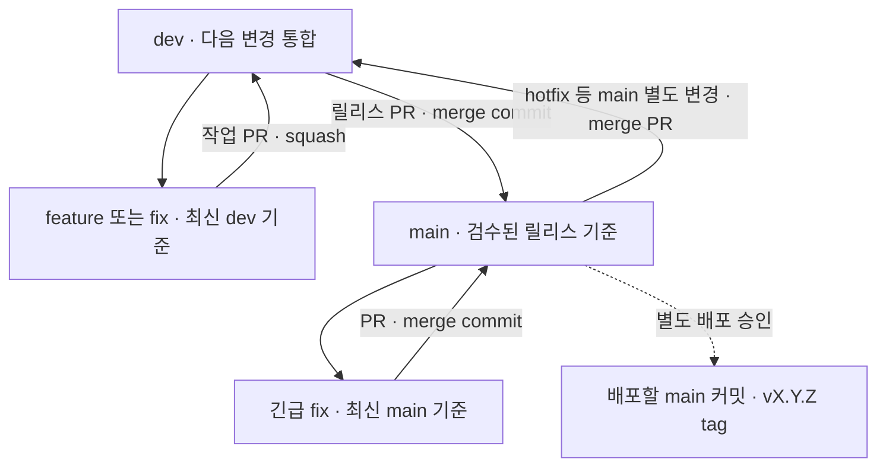

# main·dev 브랜치와 버전 운영

2026-10-25 사용자가 승인한 운영 정책의 정본입니다. 작업 범위·담당·검수 결과·다음 행동은 Munder에 기록하고, 이 문서는 반복해서 사용하는 절차를 설명합니다. 팀장(god)이 통합을 책임지고 작업마다 공통 Git 실행자 한 명을 지정합니다.

## 한 페이지 요약

| 항목           | 운영 기준                                                                                                          |
| -------------- | ------------------------------------------------------------------------------------------------------------------ |
| 상시 브랜치    | `main`: 검수된 릴리스 기준, `dev`: 다음 변경의 통합 기준                                                           |
| 일반 작업 시작 | 최신 원격 `dev`에서 단기 작업 브랜치 생성                                                                          |
| 작업 이름      | `feature/fe-jlp-ID-topic`, `feature/be-jlp-ID-topic`, `feature/devops-jlp-ID-topic` 또는 `fix/<role>-jlp-ID-topic` |
| 작업 통합      | 작업 PR → `dev`, **squash merge**                                                                                  |
| 릴리스 통합    | `dev` PR → `main`, **merge commit**                                                                                |
| main 별도 변경 | hotfix 등 실제 변경이 생긴 경우에만 `main` → `dev` PR을 **merge commit**으로 동기화                                |
| 긴급 수정      | 최신 `main`에서 단기 `fix/...` → `main` PR → 즉시 `dev` 동기화                                                     |
| 리뷰           | PR 생성·갱신 즉시 독립 QA와 팀장이 변경 검토 시작; 병합은 관련 검수와 현재 required CI 성공 후                     |
| WIP            | 작업 브랜치 checkpoint·normal push·Draft PR 허용; 실패·미실행·남은 문제 명시                                       |
| 보호           | `main`·`dev` 직접 push와 force push 금지; 실제 GitHub 설정은 원격 확인 기록으로 구분                               |
| 버전·배포      | root `package.json.version` 하나의 SemVer; 배포할 `main` 커밋에 버전 tag, main 병합과 배포는 별도                  |
| 정리           | 수용·미병합 작업·사용 중 worktree·의존을 확인한 단기 브랜치만 삭제                                                 |



## 작업 시작과 소유권

1. 팀장이 JLP ID, 목적, 허용 파일·의존, 담당과 Git 실행자를 정합니다. FE는 `apps/web`, BE는 `apps/api`·domain과 합의된 contracts, DevOps는 배정된 CI·운영을 맡습니다. root runtime·의존성·lockfile·버전·콘텐츠는 담당을 명시합니다.
2. Git 실행자가 최신 원격 `dev`와 사용 중 브랜치·worktree를 확인하고 단기 브랜치와 작업 경로를 준비합니다. 일반 작업은 최신 `dev`를 기준으로 하며, 긴급 수정만 아래 절차에 따라 `main`을 기준으로 합니다.
3. 지정 worktree의 `team/writer-state.md` Current를 취득합니다. 같은 worktree에는 source writer 한 명, 공통 Git metadata에는 지정 실행자 한 명을 유지합니다. 원본 dirty checkout, 다른 담당의 변경·index·worktree, 사용 중 서비스와 DB·볼륨·`.env`를 보존합니다.
4. 공유 계약이나 여러 영역을 건드리는 작업도 **하나의 task·작업 브랜치·PR**로 관리합니다. FE·BE가 계약과 파일 소유권을 합의하고 BE가 contracts를 작성하며 FE가 소비합니다. writer 차례를 나누고 관련 담당이 함께 검수합니다.

작업이 길어지면 작은 checkpoint를 저장하고 Draft PR로 공유합니다. 최종 QA·화면 검수·real API·모든 CI 완료를 WIP 저장의 선행 조건으로 추가하지 않습니다. 현재 실패와 미실행 범위를 PR에 남기고, WIP를 제품 완료로 표시하지 않습니다.

## PR 작성·검수·병합

1. PR target은 일반 작업이면 `dev`, 긴급 수정이면 `main`입니다. 제목은 `[영역] 변경 내용` 형태의 한국어로 현재 base→head 전체 변경을 대표합니다. 본문은 다음 세 항목으로 씁니다.

   ```text
   - 변경: 문제와 변경 후 동작
   - 검증: 실제 통과·실패·미실행과 필요한 근거 링크
   - 남은 문제: 미해결 사항과 다음 담당, 없으면 없음
   ```

2. PR 생성·갱신 즉시 독립 QA와 팀장이 changed delta를 검토합니다. Draft나 CI 대기 상태에서도 리뷰를 시작합니다. 구현 담당은 관련 unit·lint·type·build와 영향에 맞는 검사를 수행하고, UI 변경은 실제 화면 검수, API·DB 변경은 해당 검증을 추가합니다. 문서 수정에 전체 DB·브라우저 검사를 요구하지 않습니다.
3. 병합 전 현재 PR head와 최신 target을 기준으로 검토 범위와 required CI 성공을 확인합니다. head·target 또는 충돌 해결이 바뀌면 영향받는 검토와 CI를 다시 확인합니다. 실패·취소·skip·누락을 성공으로 취급하지 않습니다.
4. 같은 계정 AI팀 PR은 작성자와 다른 담당의 독립 QA와 팀장 검토를 받습니다. native 자기 PR `APPROVE`는 요구하지 않습니다. 외부 계정 PR은 여기에 **작성자와 다른 write/admin 권한 계정의 실제 승인 1건**을 더합니다.
5. 지정 Git 실행자가 검토된 작업 PR을 `dev`에 squash merge합니다. 관련 담당에게 수용 커밋과 결과를 남기고, 완료된 PR은 검토·CI가 충족되는 대로 병합 또는 사유를 명시해 종료합니다. 완료 PR을 정기 배치까지 쌓아두지 않습니다.
6. `dev`의 전체 변경을 `main`으로 올릴 때는 `dev` → `main` PR을 열고 전체 릴리스 범위·호환성·버전을 검토한 뒤 merge commit으로 수용합니다. 이 방식으로 `dev`의 변경 이력을 `main`에 보존합니다. `main`에서 hotfix 등 별도 실제 변경이 생긴 경우에만 `dev`로 merge 동기화합니다.

기존 required CI 세 개를 유지합니다.

- `Quality and production build`
- `Phase 10 real/mock browser and regression acceptance`
- `Phase 11 portable release and production-mode smoke`

위 검수·승인 기준은 운영 정책입니다. GitHub가 실제 강제하는 보호·승인 수·required checks·merge 방식은 root의 원격 조회와 설정 결과를 Munder에 따로 기록합니다. 문서 채택만으로 서버 enforcement가 완료됐다고 주장하거나, 필요한 검사가 실패한다고 보호를 낮추지 않습니다. `main`·`dev` push CI와 작업 PR의 `pull_request` CI를 유지합니다.

## 긴급 수정과 역동기화

1. Git 실행자가 최신 원격 `main`에서 `fix/<role>-jlp-ID-topic`을 준비하고 수정·관련 검사 후 `main` 대상 PR을 엽니다. QA·팀장 검토와 현재 required CI를 거쳐 merge commit으로 수용합니다.
2. 해당 `main` 커밋을 즉시 `main` → `dev` 동기화 PR로 merge합니다. 이미 열린 작업 브랜치에는 최신 `dev`를 일반 merge로 반영하고 충돌·검사 영향을 확인합니다. 공유 이력을 force로 다시 쓰지 않습니다.
3. 배포 버전은 마지막 배포 tag부터 배포할 `main`까지의 **포함된 전체 변경**으로 판단합니다. `main`에 아직 배포하지 않은 기능이 있으면 작은 버그 수정만 근거로 구버전 patch라고 표시하지 않습니다.

## 단일 제품 버전과 배포

root `package.json.version`이 제품 SemVer의 단일 원본입니다. 버전 담당은 포함된 변경과 공개 계약 영향을 검토해 값을 정하고, 다른 산출물의 제품 버전은 이 값에서 파생합니다. API 경로의 `v1`, DB migration 번호와 manifest schemaVersion은 별도 식별자입니다.

| 포함된 변경                          | 버전 판단                          |
| ------------------------------------ | ---------------------------------- |
| 0.x 호환 버그 수정                   | PATCH: 가상 예 `0.4.2` → `0.4.3`   |
| 0.x 기능 추가·계약 전환              | MINOR: 가상 예 `0.4.2` → `0.5.0`   |
| 1.x 호환 버그 수정                   | PATCH                              |
| 1.x 호환 기능 추가                   | MINOR                              |
| 1.x 공개 계약의 호환성 파괴          | MAJOR                              |
| 제품 동작에 영향 없는 문서·정책 정리 | 변경 자체만으로 버전을 올리지 않음 |

실제 배포할 `main` 커밋에 `vX.Y.Z` tag를 연결합니다. 기존 tag를 이동·재사용하거나 다른 커밋을 같은 배포 버전으로 표시하지 않습니다. `main` 병합, CI 성공, tag 생성, 실제 배포는 각각 구분하며 배포는 승인된 환경·담당·입력과 별도 실행 기록을 필요로 합니다. 이 정책 도입 작업에서는 현재 버전·tag·배포를 변경하지 않습니다.

## 브랜치 정리와 이번 전환

- 작업 PR이 수용되면 PR의 최종 head와 수용 커밋, 미반영 변경, 다른 PR·작업의 의존, 사용 중 worktree와 dirty 상태를 확인합니다. squash 후에는 단순한 ancestry 비교만으로 수용 여부를 판단하지 않습니다.
- Git 실행자는 안전하게 수용되고 사용이 끝난 단기 브랜치만 정리하고 결과를 Munder에 남깁니다. 진행 중·미병합·소유 불명·다른 PR이 참조하는 작업과 미공개 커밋을 보존합니다. dirty checkout의 reset·clean·stash나 강제 삭제로 정리하지 않습니다.
- `main`·`dev`는 상시 보존합니다. 완료한 단기 브랜치의 로컬·원격 정리는 담당 Git 실행자가 맡고, 다른 사람의 worktree는 소유자와 조정합니다.
- 이번 전환의 `dev` 생성·보호, sync PR #25/#26 종료와 `frontend`·`backend` 정리는 root의 실행 범위입니다. PR #13/#16의 미병합 작업은 보존합니다. 실제 원격 확인과 결과 기록으로 완료 여부를 판단하며, 이 문서는 그 실행이 완료됐다는 증거가 아닙니다.

## 적용 예시

1. **FE 필터 기능:** 최신 `dev` → `feature/fe-jlp-520-review-filter` → 관련 UI·계약·화면 검수 → PR을 `dev`에 squash → 사용 종료 확인 후 작업 브랜치 정리.
2. **공유 결과 계약:** `feature/be-jlp-521-result-contract` 하나에서 BE contracts와 FE 소비 파일의 담당·writer 차례를 합의 → 양쪽 관련 검사와 QA·팀장 검토 → 단일 PR을 `dev`에 squash. 릴리스 때 `dev` 전체를 `main`에 merge commit으로 수용해 해당 이력을 보존.
3. **긴급 오류 수정과 버전:** 최신 `main` → `fix/be-jlp-522-session-cookie` → `main` PR 검수·merge → 즉시 `dev` 동기화. 마지막 배포가 가상 버전 `0.4.2`이고 포함 변경이 버그뿐이면 `0.4.3`, 아직 배포하지 않은 기능도 포함하면 전체 변경 기준으로 `0.5.0`을 판단합니다. 예시 번호와 버전은 실제 작업·발표 약속이 아닙니다.
